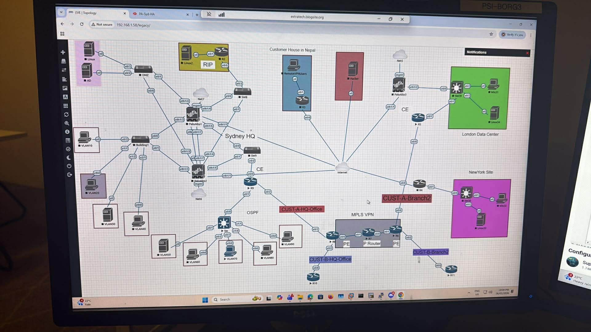
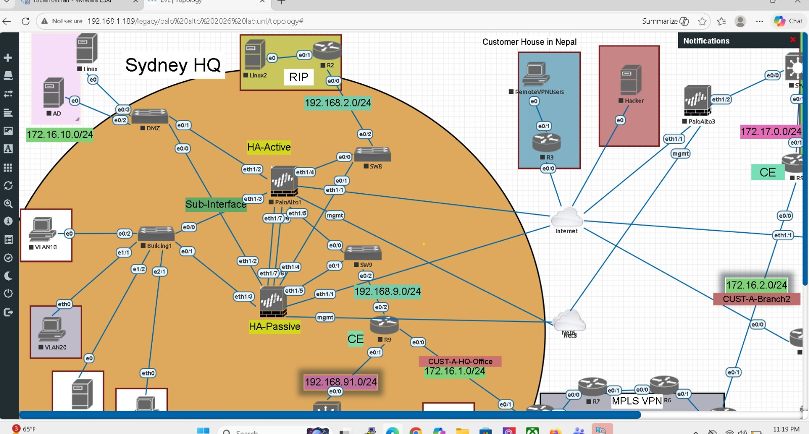

# Network topology and WAN design

The source document uses an EVE-NG lab hosted in VMware Workstation. An additional VMware NAT network (VMnet8 in the screenshots) is mapped to an EVE-NG cloud to simulate a second ISP.

## Logical traffic path

```text
 LAN clients ---------+
                      |
 DMZ clients ---------+-- Palo Alto firewall -- ethernet1/1 -- ISP 1 (simulated)
                              |
                              +------------- ethernet1/8 -- ISP 2 (VMware NAT)
```

**Diagram note:** This is a simplified logical representation of the documented interfaces, not a full cabling diagram. Source document pages 1–3, 15–21.

## Screenshot to add

- `dual-isp-topology.png` — sanitized EVE-NG topology or WAN-interface screenshot
- `vmware-nat-network.png` — VMware VMnet8 NAT setup

Remove any real credentials and sensitive management information before uploading images.

## Original multi-site EVE-NG topology captures

These are the original screenshots uploaded to the repository root.

### Full network overview



The overview includes Sydney HQ, London Data Center, New York Site, MPLS VPN and customer branches.

### Sydney HQ / Palo Alto HA detail



This view focuses on the HA-Active and HA-Passive-labelled firewalls, DMZ, VLAN endpoints, and connected routers.

These screenshots show the lab design, but do not by themselves verify successful HA failover or other feature testing.
